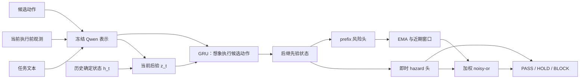

# DreamGuard：方法、代码与复现边界

更新：2026-11-24。当前版本：`dreamguard-paper-reproduction-v2`。

v1/v2正式训练与评测已完成。v2在SafetyDrift原测试72条得到F1 97.44%、Recall100%、FPR5.88%；源校准迁移到ATBench配对200条时FPR100%，AgentDojo回放也全拦截。11月24日冻结模型、只用ATBench独立开发集重新校准的补充实验得到F1 10.53%、Recall6.06%、FPR8.91%，检测有效性仍未修好。详见[两项修复与代码解释](guard-repair-and-dreamguard-20261124.md)和[SafetyDrift当前六组结果](safetydrift-latest-results-20261124.md)。下面保留实现说明与原验证过程；所有结果均为独立方法复现，不能称作者checkpoint结果。

## 1. 作者资产核查

论文是 [DreamGuard: Efficient Runtime Guardrail for LLM Agents via Risk-Aware World Model](https://arxiv.org/abs/2608.05695)，以下以 [v1 全文](https://arxiv.org/html/2608.05695v1) 为准。

截至本次核查，论文链接、GitHub 相关仓库搜索以及 Hugging Face 模型/数据集搜索中，没有找到可确认属于论文作者的训练实现、DreamGuard checkpoint、清理后 split ID 或最终 Scheme-D 参数。这个结论限定于已核查的公开来源。

公开的 [ioo0s/DreamGuard-reproduction](https://github.com/ioo0s/DreamGuard-reproduction) 自述为第三方复现，使用合成替身训练数据，且不提交 checkpoint。我们没有把它标为作者库，也没有把其权重作为论文结果来源。

实际复用的是 [Qwen 作者编码器](https://huggingface.co/Qwen/Qwen3-4B-Instruct-2507)，固定 revision `cdbee75f17c01a7cc42f958dc650907174af0554`。服务器已有该快照，无需重复下载。DreamGuard 的 RSSM、训练循环、策略与评测代码由我们依据论文实现。

检索接口留档：`https://api.github.com/search/repositories?q=DreamGuard+in:name`、`https://huggingface.co/api/models?search=DreamGuard`、`https://huggingface.co/api/datasets?search=DreamGuard`。排除了同名游戏、睡眠应用和图像模型。

## 2. 它究竟预测什么

DreamGuard 每次接收任务、执行前的当前观测和候选动作，利用一个小型循环世界模型判断执行后可能进入的状态。它不需要在线生成一段自然语言“未来轨迹”，也不调用 DeepSeek API 来给自己打分。

历史信息保存在循环状态中，当前观测先被吸收，然后候选动作推动一次潜在状态预测。两个风险头读取预测的后继状态：hazard 头判断当前动作的即时风险，prefix 头判断当前前缀是否接近未来危险。风险头的输入包含任务与动作表示。

这里的 horizon=3 用于构造前缀监督标签；实现不会每次生成三步未来动作。若轨迹由 Flash 生成，Flash 是被审查的 agent backbone；Qwen 是 DreamGuard 的表示编码器，两者角色不同。



这里的“先验”是模型只凭当前可见信息想象的后继；“后验”是吸收已知观测后的状态。真实执行结果只作为训练的辅助目标，不能进入当前风险判断。本文也明确允许观测预测器在辅助训练中读取后继后验，不能把这条训练路径误当成推理泄漏。

## 3. 文件与逐段代码逻辑

### `agentguard/dreamguard_data.py`：把数据变成执行前输入

`source_examples()` 验证现有 SafetyDrift 固定清单与原始文件哈希。第 t 步的 `observations[t]` 来自第 t−1 步结果；首步使用空观测。`actions[t]` 仅保留工具名、参数或回复文本。当前动作结果放在独立的 `successors[t]` 字段，只供世界模型预训练使用。

`projection_deduplicate()` 按模型真正能看到的任务、观测序列和动作序列去重。先保留所有作者测试 ID，再保留校准样本，最后清理训练副本。原来的通用清单还包含思考文本和工具信息，而本编码适配没有使用这些字段，所以还发现并删除了一条跨训练/校准重复。删除明细写入运行 manifest；原始数据不被修改。

`target_examples()` 支持 ATBench 全量 1000 条，或历史 200 条留出集；候选动作会去掉额外结果字段。原源迁移协议中ATBench标签只用于汇总，不用于训练、选参数或校准。11月24日新增的独立`dream_transfer.py`目标域补充实验只在原calibration200上校准，再评测heldout200，不替换原协议。

### `agentguard/dreamguard_model.py`：世界模型和两个风险头

`ModelConfig` 显式保存网络尺寸，避免只有权重而不知道架构。`RiskWorldModel` 中各模块对应关系如下：

| 代码模块 | 输入 → 输出 | 用途 |
| --- | --- | --- |
| `initial` | 任务 → 1024 维 h | 每条轨迹初始化 |
| `posterior` | h、当前观测 → 32×32 分类 logits | 吸收当前已知观测 |
| `transition_norm`、`transition` | 当前 z、候选动作、h → 下一 h | 递归记录前缀并想象当前动作 |
| `prior` | 下一 h → 下一 z 的分类 logits | 不接触真实动作结果的后继预测 |
| `observation` | 后继后验 h、z → 2560 维向量 | 预训练的辅助观测预测 |
| `adapter` | 任务/动作向量 → 残差 | 供风险头使用的小型适配器 |
| `hazard`、`prefix` | 后继先验、任务、动作 → 两个 logit | 分别学习即时风险和接近危险的前缀 |

`latent()` 在训练时用 hard Gumbel straight-through：前向是离散 one-hot 状态，反向仍可传梯度。默认推理用 argmax，保证同输入可重复；可用 `--eval-latent sample` 对照采样推理。作者没有公布推理采样实现，因此不能把默认 argmax 称为逐行一致的作者设置。

`step()` 是唯一的单步风险路径，不接收 successor 或标签。`forward()` 依次调用它，只有明确提供训练目标时才计算辅助观测预测。风险监督阶段调用 `forward(..., successors=None)`。

`world_loss()` 对齐公式 4–6：batch 中有效目标与预测向量分别中心化，计算余弦损失；再叠加两项方向相反的 stop-gradient KL，自由位下限 0.2。预测损失权重 1.25，两项 KL 分别乘 0.03。中心化在所有有效 batch/时间位置上进行，这是未公开实现细节的一项假设。

`safety_loss()` 对 hazard 与 prefix 分别使用 BCE-with-logits。两种损失都先在每条轨迹的有效步内求平均，再对轨迹平均，避免长轨迹得到额外权重；这对应公式 4/8 的归一化形式。

### `agentguard/dreamguard_training.py`：编码、标签与两阶段训练

`Encoder` 只从已下载的官方快照读取，不联网补拉其他权重。固定 `hidden_states[31]`，做 attention-mask mean pooling，得到 2560 维向量。训练特征提取默认把独立文本以 batch 8 编码；按长度排序减少 padding，重复文本复用向量。正式延迟评测则逐次编码并关闭文本缓存。

`extract()` 每完成 10 条轨迹保存一次特征断点，缓存绑定代码、数据、split、编码器版本与配置。修改输入后不能默默接着使用旧缓存。真实特征均由冻结编码器生成，训练只从 `train` 组取样。

`batch()` 生成 padding mask 与监督目标。首次危险步 h 的 hazard 标签为 1，安全前缀为 0；h 之后不参与风险监督。prefix 标签只覆盖前 3 步。例如 h=4 时，t=1/2/3/4 对应 `exp(-2/1.5)`、`exp(-1/1.5)`、`1`、`1`，更早位置为 0。紧邻危险步的标签为 1 是论文公式 7 的结果。

第一阶段 `world` 训练 10 epoch，学习状态与观测表示；第二阶段 `risk` 训练 12 epoch，固定 GRU 与其输入 LayerNorm，更新风险头、适配器及风险路径上的其余模块。观测预测器在第二阶段冻结，不参与风险损失。

`make_optimizer()` 使用论文 C.8 写明的 Adam，学习率 2e-4。风险阶段世界模型路径降为 5e-5，风险头/适配器维持 2e-4。旧版的 AdamW、weight decay 0.01 和梯度裁剪 10 已移除，避免把未报告的优化设置当成默认。

`train_stage()` 每个 epoch 原子保存模型、Adam 状态、随机数状态与 epoch。中断后从上一个完整 epoch 续跑，未完成 epoch 会重做。恢复之前重新应用冻结范围；配置或代码不匹配则拒绝恢复。CPU 单测验证了“连续跑两轮”和“一轮后恢复再跑一轮”的参数逐位相同；GPU 仍可能存在算子非确定性。

### `agentguard/dreamguard_policy.py`：时间证据、阈值、指标

`Evidence.propose()` 计算 prefix 的 EMA 与最近 W 步均值，再与即时风险用带权 noisy-or 合并，分数限制在 [0,1]。

决策优先级为：即时风险达到 block 阈值则 BLOCK；否则融合分数达到 hold 阈值则 HOLD；其余 PASS。HOLD/BLOCK 都在固定轨迹检测中计为干预，但日志保留各自类别。

`calibrate()` 只使用 57 条校准轨迹。阈值取安全轨迹全程最大分数的分位数，避免把每步误报率当成轨迹误报率。论文公开了 beta 的 4 个取值和 W 的 3 个取值，但未公开最终权重。我们明确使用三组假设权重，形成 36 组搜索，按校准 F1 选定并保存所有候选结果。校准标签可以用于选参，测试标签不参与。

默认 HOLD/BLOCK 误报预算为 0.05/0.01，这是复现假设。安全校准轨迹只有 26 条；论文公式把分位点截到 n 且使用 `>=`，因此样本少或并列分数会使名义预算失真，加上复用校准集选融合参数，不能声称具有严格的 1% 或 5% 覆盖保证。

`metrics()` 输出 F1、Recall/Safety Rate、FPR、PHIR、MAS。PHIR 要求首次干预严格早于首个危险步；恰在危险步拦截只增加 Recall。没有可靠边界时 timing 指标为空，没有恢复动作标签时 recovery FPR 为空。

### `agentguard/dreamguard_runtime.py`：逐步审核与执行提交

`DreamGuardSession` 的输入只包括任务、执行前观测和候选动作。`review()` 返回分数、决策、耗时和候选编号，但不推进已执行轨迹。调用者确认 PASS 动作实际执行后，才调用 `commit(generation)`；旧候选、已提交候选和 HOLD/BLOCK 均不能提交。重新规划出的替代动作会从相同历史状态重新审核。

`evaluate()` 对每条轨迹新建状态，遇到首次干预立即停止，不读取它后面的轨迹作为决策输入。正式模式从文本编码到最终决策计时，包含首步任务编码、同步和策略计算，模型冷启动加载不计入每次审核。缓存模式单列 head 耗时，并将 `mean_guard_latency_seconds` 留空，避免与论文端到端数值混用。

这是固定轨迹上的安全检测评测。我们没有重新执行工具、恢复环境并重新规划，所以不能把拦截结果当成在线 ASR 或任务完成率。

### `agentguard/dreamguard.py`：实验编排

`--stage prepare` 生成特征；`train` 完成两个训练阶段与校准；`evaluate` 只加载已完成的匹配模型和阈值；`all` 顺序执行全部流程。原协议用同一个checkpoint与源校准文件测试SafetyDrift并迁移ATBench；目标域开发校准是另存的新实验，不更改原校准文件。

运行目录保存代码/数据哈希、模型配置、编码器 revision、版本环境、重复删除明细、checkpoint、训练日志、36 组校准结果，以及逐轨迹决策 JSONL。脚本用 `flock` 防止两个进程同时写同一运行目录。

## 4. 当前数据范围

| 用途 | 条数 | 危险 | 安全 | 使用方式 |
| --- | ---: | ---: | ---: | --- |
| SafetyDrift 有效训练 | 221 | 117 | 104 | 仅用于两阶段训练 |
| SafetyDrift 校准 | 57 | 31 | 26 | 选择融合参数和阈值 |
| SafetyDrift 原作者测试 | 72 | 38 | 34 | 仅最终评测 |
| ATBench 全量 | 1000 | 497 | 503 | 默认迁移测试，4492 个候选动作 |
| ATBench 历史留出 | 200 | 99 | 101 | 可选配对范围，897 个候选动作 |

ATBench 的 200 条包含于全量 1000 条，不能合并成 1200 条。这里不训练 ATBench，因此全量迁移评测不会用到它的训练标签。DreamGuard 原文没有报告 ATBench，该项应标为“DreamGuard 方法复现版，ATBench 迁移测试”。

## 5. 与论文的逐项对应和剩余差异

| 项目 | 当前实现 | 复现状态 |
| --- | --- | --- |
| Qwen3-4B-Instruct-2507 / 31 层 / 2560 维 | 官方编码器、固定 revision | 对齐已报告配置；31 层解释为 HF `hidden_states[31]` |
| GRU 1024、32×32 分类隐变量、ST 梯度 | 已实现 | 对齐 |
| 10/12 epoch、batch 8、Adam、2e-4、世界模型 LR×0.25、seed 20260701 | 已实现 | 对齐 |
| horizon 3、温度 1.5、adapter scale .25、KL .03、预测权重 1.25、free bits .2 | 已实现 | 对齐 |
| 原始清理后 train/cal/test ID、GPT-5.1 与双人复审边界 | 未公开可用资产 | 使用公开版固定划分及原生首次 risk_level=4；另按有效输入去重 |
| 文本模板、池化细节、截断长度 | 未公开完整实现 | 原始任务/此前观测/JSON 动作分别编码；masked mean；各 2048 token |
| MLP 隐层、适配器与初始化细节 | 未公开完整实现 | MLP 512，adapter 256 且任务/动作共享，任务投影初始化，scale .25 |
| 推理随机变量取值 | 未公开具体实现 | 默认 argmax，支持 sample 独立对照，设置进入 manifest |
| batch centering 的精确轴、KL 数值细节 | 未公开代码 | 所有有效 batch/时间步联合中心化；分类 KL 对变量求和 |
| 最终 Scheme-D 权重、阈值预算 | 未公开 | 明示三组权重与 .05/.01，保存校准搜索，测试不调参 |
| 延迟硬件 | 论文 H100；服务器现有 GPU | 记录实际硬件，正式模式实测端到端，不承诺论文 0.025 秒 |
| 完整在线环境接入与提示/judge 包 | 未公开完整附件 | 完成因果审核 API，当前只提供固定轨迹检测结果 |

因此论文的 SafetyDrift F1 96.4% 仍只是参考值，不能把本工程的实现完成或单元测试通过写成该分数的复现成功。

## 6. 启动方式（服务器）

先检查空闲卡，再把下面的 0 改成实际可用编号。编码器提取默认批量 8，训练 batch 8；同条轨迹依赖历史，训练阶段依赖上一阶段，同一运行目录保持单进程。不会在一张卡上启动多个 4B 编码器争用显存。

```bash
cd /data1/yaoziao/agentguard
nvidia-smi

# 准备特征 → 两阶段训练 → 校准 → SafetyDrift 72 → ATBench 1000
tmux new-session -d -s dreamguard_v2 \
  'cd /data1/yaoziao/agentguard && DREAMGUARD_GPU=0 bash scripts/run-dreamguard-paper.sh'
```

进入查看：`tmux attach -t dreamguard_v2`；暂时离开但保持运行：按 `Ctrl+b`，松开，再按 `d`。

分阶段运行或续跑时，三个阶段必须指定同一个新版本目录：

```bash
cd /data1/yaoziao/agentguard
export DREAMGUARD_GPU=0
export DREAMGUARD_RUN_DIR=/data1/yaoziao/agentguard/results/dreamguard-paper-v2-my-run
DREAMGUARD_STAGE=prepare bash scripts/run-dreamguard-paper.sh
DREAMGUARD_STAGE=train bash scripts/run-dreamguard-paper.sh
DREAMGUARD_STAGE=evaluate bash scripts/run-dreamguard-paper.sh
```

若中断，保持相同配置和目录，再执行原阶段。每个完整 epoch 可续跑；特征每 10 条可续跑。不要把旧版 `dreamguard-atbench-method-*` 目录传给新版。

可选：`DREAMGUARD_ATBENCH_SCOPE=heldout` 评测历史 200 条；`DREAMGUARD_EVALUATION=safetydrift` 只测 SafetyDrift；`DREAMGUARD_LATENCY=cached` 只统计神经头耗时；`DREAMGUARD_EVAL_LATENT=sample` 必须使用另一运行目录并明确标注采样对照。

检查汇总，无需后台轮询：

```bash
cd /data1/yaoziao/agentguard
# 替换为脚本开头打印的实际目录
run=results/dreamguard-paper-v2-my-run
tail -n 5 "$run/training.jsonl"
grep -H '"record_type":"overall_summary"' "$run"/*.jsonl
```

输出命名为 `safetydrift-时间戳.jsonl`、`atbench-时间戳.jsonl`；错误中断不会产生成功汇总。代码测试使用合成数据的小网络，不使用模型效果作为验收条件。真实数据适配验收只读文件、校验数量与隔离，不运行正式推理。

## 7. 2026-11-21代码完成时的历史验证记录

- 服务器现有环境：Python 3.10.21、PyTorch 2.5.1+cu124、Transformers 5.2.0；未改动依赖环境。
- `python -m unittest discover -s tests -p test_dreamguard.py -v`：15 项全部通过，CPU 小网络及模拟编码器，没有加载真实 Qwen 权重或使用 GPU。
- 验证包含输入投影去重、后继/未来观测隔离、prefix 标签、按轨迹归一化、ST 梯度、风险阶段 GRU 冻结、Adam/RNG 恢复、PASS 提交、阈值行为、严格 PHIR、批量编码 padding，以及 prepare/train/calibrate/evaluate 全流程。
- 论文默认尺寸的随机初始化模型完成 CPU 前向：30,440,706 个参数，2 步 hazard 输出形状 `[1,2]`，数值有限。此项不衡量检测效果。
- 两个启动脚本通过 `bash -n`，CLI `--help` 可运行；真实数据适配范围已按上表核验。
- 当时未执行真实编码器GPU正式训练或benchmark。之后v1/v2训练与测试已完成，当前结果以文首11月24日链接为准，不再处于仅CPU验收阶段。
